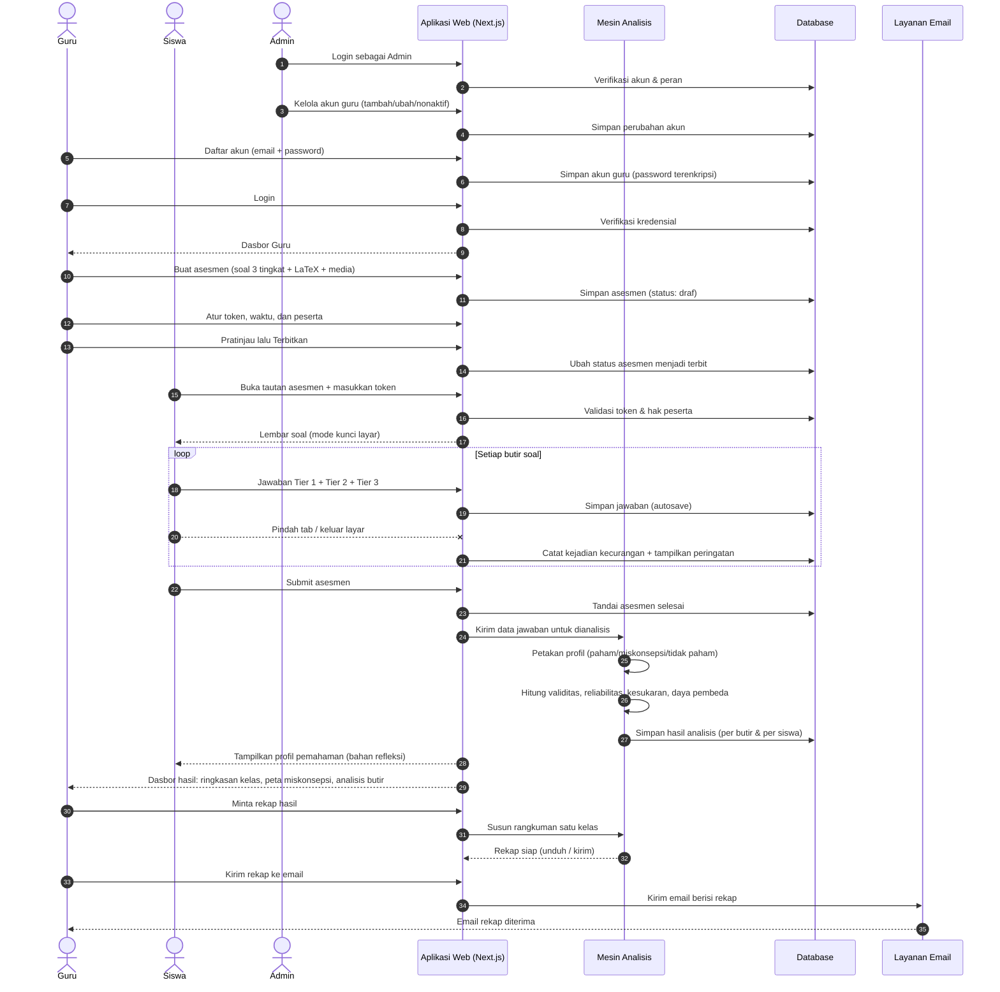
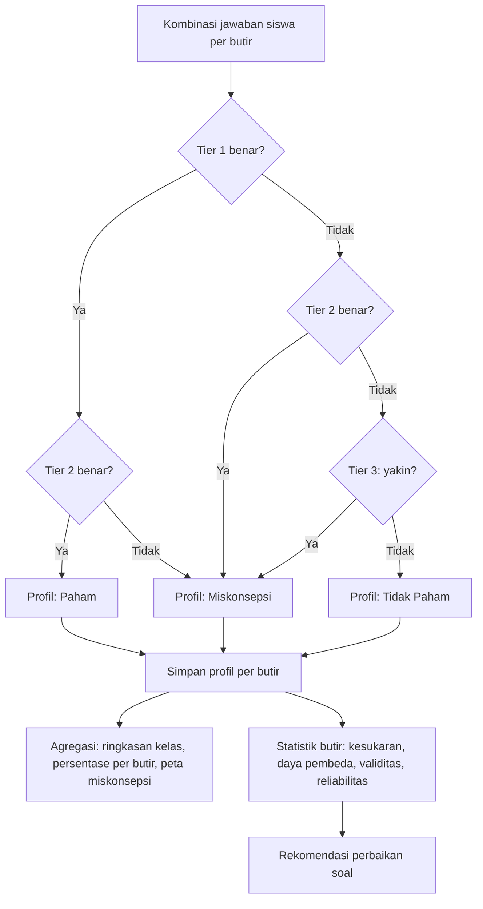
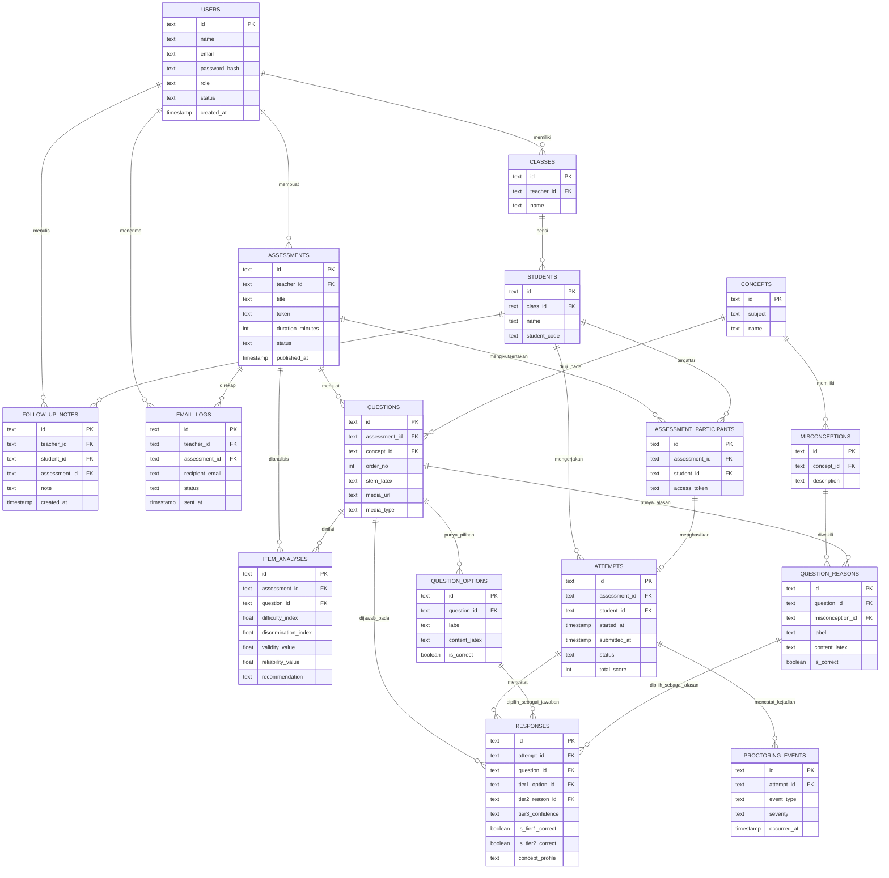

# PRD — Project Requirements Document

## 1. Overview

### Masalah yang Diselesaikan

Guru perlu melakukan **asesmen diagnostik** — baik di awal pembelajaran (untuk menyusun strategi pembelajaran yang adaptif) maupun di akhir pembelajaran (untuk mengukur pemahaman siswa setelah pengajaran). Masalahnya:

1. **Guru sulit mengetahui letak miskonsepsi siswa.** Nilai rendah belum tentu berarti siswa tidak paham — bisa jadi siswa punya konsep yang salah (miskonsepsi) dan justru perlu penanganan berbeda.
2. **Pengoreksian soal tiga tingkat (three-tier) memakan waktu.** Guru harus memeriksa jawaban, alasan, dan tingkat keyakinan siswa satu per satu secara manual.
3. **Kualitas soal sulit dievaluasi.** Guru tidak punya data untuk menilai apakah soal terlalu mudah, terlalu sulit, atau mampu membedakan siswa paham dan belum paham.
4. **Kecurangan saat ujian daring sulit dibuktikan.** Guru tidak memiliki bukti ketika siswa berpindah tab atau mencari jawaban di luar halaman asesmen.
5. **Perkembangan siswa tidak terpantau.** Tidak ada rekam jejak pemahaman siswa dari satu asesmen ke asesmen berikutnya.

### Tujuan Utama Aplikasi

Membangun **aplikasi web asesmen diagnostik** yang:

- Dapat diakses **daring melalui smartphone maupun laptop** tanpa perlu memasang aplikasi tambahan.
- Menyediakan **dua peran pengguna**: **Admin** (pemegang kendali penuh atas sistem dan akun) dan **Guru** (pengguna utama yang menyusun asesmen dan membaca hasil).
- Mendukung **soal pilihan ganda tiga tingkat** yang memuat **rumus matematika (LaTeX)** serta **media (gambar, video, audio, grafik)**.
- Menganalisis kombinasi jawaban siswa **secara otomatis** dan menghasilkan **3 profil pemahaman konsep**: **Tidak Paham**, **Miskonsepsi**, dan **Paham**.
- Memberi **umpan balik langsung kepada siswa** setelah submit sebagai bahan refleksi.
- Memberi guru **hasil analisis butir soal** (validitas, reliabilitas, tingkat kesukaran, daya pembeda) sekaligus **rekomendasi perbaikan soal**.
- Memantau **progress siswa** dari waktu ke waktu dan menandai siswa yang masih perlu perhatian.
- Memberikan **bukti anti-cheat** dan **laporan kecurangan** per asesmen.
- Menghasilkan **rekap hasil** yang dapat diunduh dan **dikirim ke email guru**.

### Keunggulan Utama

> **Guru langsung tahu di mana letak miskonsepsi siswanya** — bukan sekadar nilai akhir, tetapi penjelasan konsep mana yang salah dipahami dan siapa yang memerlukannya.

---

## 2. Requirements

### 2.1 Kebutuhan Fungsional

**A. Autentikasi & Peran**
| Kode | Kebutuhan |
|---|---|
| F-01 | Sistem memiliki dua peran: **Admin** dan **Guru**. |
| F-02 | Guru dapat **mendaftar akun** menggunakan email dan password. |
| F-03 | Guru dapat **login dan logout** dengan aman. |
| F-04 | Guru dapat **mengatur ulang password** jika lupa. |
| F-05 | Admin dapat **menambah, mengubah, dan menonaktifkan** akun guru. |
| F-06 | Admin memiliki akses ke seluruh data dan aktivitas sistem. |

**B. Penyusunan Asesmen**
| Kode | Kebutuhan |
|---|---|
| F-07 | Guru dapat membuat asesmen berisi **soal pilihan ganda tiga tingkat** (Tier 1: jawaban, Tier 2: alasan, Tier 3: tingkat keyakinan). |
| F-08 | Guru dapat menyisipkan **rumus matematika (LaTeX)** pada soal dan pilihan jawaban/alasan. |
| F-09 | Guru dapat menyisipkan **media: gambar, video, audio, dan grafik** pada soal. |
| F-10 | Guru dapat menetapkan **token masuk** dan **batas waktu** pengerjaan. |
| F-11 | Guru dapat memilih **kelas atau siswa** yang boleh mengerjakan asesmen. |
| F-12 | Guru dapat **mempratinjau** tampilan soal sebelum menerbitkan asesmen. |
| F-13 | Guru dapat menyimpan asesmen sebagai draf dan menerbitkannya kapan saja. |

**C. Pengerjaan Asesmen oleh Siswa**
| Kode | Kebutuhan |
|---|---|
| F-14 | Siswa masuk ke asesmen hanya dengan **token** yang diberikan guru (tanpa perlu membuat akun). |
| F-15 | Siswa menjawab **tiga tingkat** pada setiap butir: pilihan jawaban, pilihan alasan, dan tingkat keyakinan. |
| F-16 | Jawaban **tersimpan otomatis** selama pengerjaan, termasuk saat koneksi terputus. |
| F-17 | Setelah submit, siswa melihat **profil pemahaman** dirinya (paham / miskonsepsi / tidak paham) sebagai bahan refleksi. |

**D. Analisis Otomatis**
| Kode | Kebutuhan |
|---|---|
| F-18 | Sistem menyimpan **kombinasi jawaban Tier 1 + Tier 2 + Tier 3** setiap butir dan menganalisisnya otomatis. |
| F-19 | Sistem menetapkan **profil pemahaman konsep** per butir dan per siswa. |
| F-20 | Sistem menghitung **persentase profil pemahaman** pada setiap butir soal untuk guru. |
| F-21 | Sistem menghitung **kualitas butir soal**: uji validitas, reliabilitas, tingkat kesukaran, dan indeks daya pembeda berdasarkan jawaban Tier 1 dan Tier 2. |
| F-22 | Sistem memberi **rekomendasi perbaikan** untuk butir soal yang perlu diperbaiki atau diganti. |
| F-23 | Sistem menyusun **peta miskonsepsi** (konsep yang paling sering salah dipahami). |

**E. Pengawasan Ujian (Anti-Cheat)**
| Kode | Kebutuhan |
|---|---|
| F-24 | Sistem mencatat **aktivitas pindah tab / keluar dari halaman** asesmen. |
| F-25 | Sistem **mengunci layar ujian** (mode fokus penuh) selama pengerjaan. |
| F-26 | Sistem menampilkan **peringatan otomatis** saat siswa terindikasi curang. |
| F-27 | Guru dapat melihat **laporan kecurangan** per asesmen. |

**F. Progress & Tindak Lanjut**
| Kode | Kebutuhan |
|---|---|
| F-28 | Guru dapat melihat **riwayat asesmen** setiap siswa. |
| F-29 | Guru dapat melihat **grafik perkembangan** pemahaman siswa antar waktu. |
| F-30 | Sistem menandai **siswa yang perlu perhatian** (miskonsepsi belum berubah setelah remedial). |
| F-31 | Guru dapat menyimpan **catatan tindak lanjut / rencana remedial** per siswa. |

**G. Rekap & Distribusi**
| Kode | Kebutuhan |
|---|---|
| F-32 | Guru memperoleh **rangkuman hasil** satu kelas dalam satu halaman ringkas. |
| F-33 | Guru dapat **mengunduh rekap** untuk arsip atau cetak. |
| F-34 | Guru dapat **mengirim rangkuman hasil ke email** langsung dari aplikasi. |

### 2.2 Kebutuhan Non-Fungsional

| Aspek | Ketentuan |
|---|---|
| **Kompatibilitas** | Berjalan baik di browser modern pada **smartphone dan laptop** (responsif). |
| **Kinerja** | Halaman asesmen termuat < 3 detik pada koneksi 4G; penyimpanan jawaban otomatis < 1 detik. |
| **Keandalan** | Jawaban siswa tidak hilang saat koneksi terputus atau perangkat mati mendadak. |
| **Keamanan** | Password disimpan terenkripsi (hashing); token asesmen bersifat acak dan sekali pakai per siswa. |
| **Kapasitas** | Satu asesmen mampu menampung minimal **1 kelas (≈40 siswa)** mengerjakan bersamaan. |
| **Usability** | Alur guru dan siswa dapat dipahami tanpa pelatihan teknis; antarmuka berbahasa Indonesia. |
| **Audit** | Semua aktivitas kecurangan dan perubahan akun tercatat dengan waktu kejadian. |

---

## 3. Core Features

### Fase 1 — Melihat Hasil & Miskonsepsi

**Profil Pemahaman** `[prioritas tinggi]` — *Guru langsung melihat siswa mana yang paham, miskonsepsi, atau tidak paham setelah asesmen dikerjakan.*
- **Ringkasan Kelas** — Lihat sekilas berapa siswa yang paham, miskonsepsi, dan tidak paham dalam satu kelas.
- **Profil per Siswa** — Buka rincian profil pemahaman setiap siswa beserta butir yang dijawabnya.
- **Peta Miskonsepsi** — Temukan konsep mana yang paling sering salah dipahami oleh siswa.
- **Filter & Pencarian** — Saring hasil berdasarkan kelas, asesmen, atau nama siswa.

### Fase 2 — Menilai Kualitas Soal & Memantau Perkembangan

**Analisis Butir Soal** — *Guru mengetahui kualitas setiap butir soal dari jawaban siswa pada tier 1 dan tier 2.*
- **Tingkat Kesukaran** — Lihat butir mana yang terlalu mudah atau terlalu sulit bagi siswa.
- **Daya Pembeda** — Ketahui butir mana yang mampu membedakan siswa paham dan belum paham.
- **Uji Validitas & Reliabilitas** — Ketahui apakah soal sudah layak dipakai berdasarkan pola jawaban siswa.
- **Rekomendasi Perbaikan** — Dapatkan saran butir mana yang perlu diperbaiki atau diganti.

**Progress Siswa** — *Guru memantau perkembangan pemahaman siswa dari satu asesmen ke asesmen berikutnya.*
- **Riwayat Asesmen** — Lihat semua asesmen yang pernah dikerjakan oleh setiap siswa.
- **Grafik Perkembangan** — Pantau naik-turunnya pemahaman siswa dari waktu ke waktu.
- **Siswa Perlu Perhatian** — Temukan siswa yang miskonsepsinya belum berubah setelah remedial.
- **Catatan Tindak Lanjut** — Simpan catatan atau rencana remedial untuk setiap siswa.

### Fase 3 — Membuat Asesmen & Mengawasi Ujian

**Kelola Asesmen** `[prioritas tinggi]` — *Guru menyusun soal tiga tingkat lengkap dengan rumus dan media, lalu membagikannya ke siswa.*
- **Susun Soal 3 Tingkat** — Buat soal pilihan ganda tiga tingkat beserta pilihan alasan pada tiap butir.
- **Tulis Rumus & Media** — Sisipkan rumus matematika, gambar, video, audio, dan grafik ke dalam soal.
- **Atur Token & Waktu** — Tentukan token masuk serta batas waktu pengerjaan asesmen.
- **Pilih Peserta** — Tentukan kelas atau siswa yang boleh mengerjakan asesmen.
- **Pratinjau & Terbitkan** — Cek tampilan soal sebelum asesmen dibagikan ke siswa.

**Pengerjaan Asesmen** `[prioritas tinggi]` — *Siswa mengerjakan asesmen dengan token dan langsung menerima hasil profil pemahamannya.*
- **Masuk dengan Token** — Siswa membuka asesmen hanya dengan token yang diberikan guru.
- **Jawab Soal 3 Tingkat** — Siswa memilih jawaban, alasan, dan tingkat keyakinan pada tiap butir.
- **Simpan Otomatis** — Jawaban siswa tersimpan selama pengerjaan meski koneksi terputus.
- **Hasil & Refleksi** — Setelah submit, siswa melihat profil pemahamannya sebagai bahan refleksi.

**Pengawasan Ujian** `[prioritas tinggi]` — *Guru mendapat bukti bila siswa mengerjakan asesmen dengan cara yang tidak jujur.*
- **Deteksi Pindah Tab** — Sistem mencatat bila siswa keluar dari halaman asesmen.
- **Kunci Layar Ujian** — Halaman asesmen terkunci penuh selama siswa mengerjakan soal.
- **Peringatan Otomatis** — Siswa mendapat peringatan saat terindikasi melakukan kecurangan.
- **Laporan Kecurangan** — Guru melihat daftar siswa dengan aktivitas mencurigakan pada tiap asesmen.

### Fase 4 — Rekap, Email & Akun

**Rekap & Kirim Email** — *Guru memperoleh rangkuman hasil asesmen yang siap diarsipkan atau dikirim ke email.*
- **Rangkuman Hasil** — Dapatkan rekap hasil asesmen satu kelas dalam satu halaman ringkas.
- **Unduh Rekap** — Unduh rangkuman hasil dalam bentuk berkas untuk arsip atau cetak.
- **Kirim ke Email** — Kirim rangkuman hasil langsung ke email guru.

**Akun & Pengguna** — *Guru dapat mendaftar dan masuk ke aplikasi, sementara admin mengendalikan seluruh akun.*
- **Daftar Akun Guru** — Guru membuat akun dengan email dan password.
- **Login & Logout** — Guru masuk dan keluar dari akunnya dengan aman.
- **Reset Password** — Guru memulihkan akses akun saat lupa password.
- **Kelola Akun oleh Admin** — Admin dapat menambah, mengubah, atau menonaktifkan akun guru.

---

## 4. User Flow

### 4.1 Alur Guru (Guru Baru)

1. **Buka situs** melalui browser di laptop atau smartphone.
2. **Daftar akun** dengan email dan password (kemenangan pertama guru).
3. **Login** ke dasbor guru.
4. **Buat asesmen baru** → tentukan judul, kelas sasaran, waktu, dan token.
5. **Susun butir soal tiga tingkat**:
   - Tier 1: pertanyaan pilihan ganda (boleh memuat rumus LaTeX, gambar, video, audio, grafik).
   - Tier 2: pilihan alasan atas jawaban Tier 1.
   - Tier 3: siswa menyatakan keyakinan atas jawabannya.
6. **Pratinjau** tampilan soal → perbaiki bila perlu.
7. **Terbitkan asesmen** → bagikan token ke siswa (tatap muka atau daring).
8. Siswa mengerjakan → guru **melihat progres pengerjaan** secara langsung.
9. Setelah selesai, buka **Profil Pemahaman**: ringkasan kelas, profil per siswa, peta miskonsepsi.
10. Buka **Analisis Butir Soal**: tingkat kesukaran, daya pembeda, validitas, reliabilitas, rekomendasi perbaikan.
11. Buka **Progress Siswa**: bandingkan hasil antar asesmen, tandai siswa perlu perhatian, simpan catatan remedial.
12. Buka **Laporan Kecurangan** untuk asesmen tersebut bila ada indikasi.
13. **Rekap hasil** → unduh dan/atau **kirim ke email**.
14. Lakukan **remedial**, lalu ulangi dari langkah 4 untuk asesmen berikutnya.

### 4.2 Alur Siswa

1. **Buka tautan asesmen** di smartphone/laptop.
2. **Masukkan token** dari guru.
3. **Mulai mengerjakan** → layar terkunci penuh (mode ujian).
4. Untuk setiap butir: **pilih jawaban → pilih alasan → pilih tingkat keyakinan**.
5. Jawaban **tersimpan otomatis**; siswa dapat melanjutkan meski koneksi sempat terputus.
6. Bila berpindah tab → **muncul peringatan** dan kejadian dicatat sistem.
7. **Submit** setelah semua butir terjawab (atau waktu habis).
8. **Lihat hasil & refleksi**: profil pemahaman (paham / miskonsepsi / tidak paham) beserta butir yang perlu diperbaiki.

### 4.3 Alur Admin

1. **Login** ke dasbor admin.
2. **Lihat daftar akun guru** beserta status aktif/nonaktif.
3. **Tambah akun guru** baru bila diperlukan.
4. **Ubah data akun** (nama, email, status) atau **nonaktifkan** akun yang tidak dipakai.
5. **Pantau aktivitas sistem**: asesmen yang dibuat, jumlah peserta, dan kejadian kecurangan yang tercatat.

### 4.4 Aturan Penentuan Profil Pemahaman (Mesin Analisis)

Kombinasi jawaban Tier 1 (jawaban), Tier 2 (alasan), dan Tier 3 (keyakinan) dipetakan sebagai berikut:

| Jawaban (Tier 1) | Alasan (Tier 2) | Keyakinan (Tier 3) | Profil Pemahaman |
|---|---|---|---|
| Benar | Benar | Yakin | **Paham** |
| Benar | Benar | Tidak yakin | **Paham** |
| Benar | Salah | Yakin | **Miskonsepsi** |
| Benar | Salah | Tidak yakin | **Tidak Paham** |
| Salah | Benar | Yakin | **Miskonsepsi** |
| Salah | Benar | Tidak yakin | **Tidak Paham** |
| Salah | Salah | Yakin | **Miskonsepsi** |
| Salah | Salah | Tidak yakin | **Tidak Paham** |

Hasil pemetaan ini menjadi dasar **profil per butir**, **persentase per butir**, **ringkasan kelas**, **peta miskonsepsi**, dan **grafik perkembangan siswa**.

---

## 5. Architecture

### 5.1 Gambaran Sistem

Aplikasi berbasis web dengan arsitektur **client–server** sederhana:

- **Client (Browser)** — Antarmuka guru, siswa, dan admin; menampilkan rumus (LaTeX) dan media; menjalankan pemantauan anti-cheat (deteksi pindah tab, mode fokus penuh); menyimpan jawaban sementara secara lokal sebelum dikirim.
- **Server Aplikasi** — Menangani autentikasi & peran, pengelolaan asesmen dan soal, penyimpanan jawaban, menjalankan mesin analisis, dan menyusun rekap.
- **Database** — Menyimpan akun, kelas, siswa, asesmen, butir soal, jawaban, hasil analisis, catatan tindak lanjut, dan log kecurangan.
- **Layanan Pendukung** — Penyimpanan berkas media (gambar/video/audio) dan layanan pengiriman email.
- **Mesin Analisis** — Modul yang mengubah kombinasi jawaban menjadi profil pemahaman dan menghitung statistik butir soal.

### 5.2 Diagram Alur Utama (Sequence)

### 5.3 Diagram Modul Analisis Otomatis (Flow)

---

## 6. Database Schema

### 6.1 Daftar Tabel

| Tabel | Fungsi Utama |
|---|---|
| `users` | Akun admin dan guru. |
| `classes` | Data kelas yang dikelola guru. |
| `students` | Data siswa (tanpa akun login). |
| `assessments` | Asesmen yang dibuat guru, termasuk token dan waktu. |
| `assessment_participants` | Daftar siswa yang berhak mengerjakan tiap asesmen. |
| `concepts` | Konsep/kompetensi yang diuji. |
| `misconceptions` | Daftar miskonsepsi yang mungkin muncul pada tiap konsep. |
| `questions` | Butir soal (Tier 1) beserta rumus LaTeX dan media. |
| `question_options` | Pilihan jawaban Tier 1. |
| `question_reasons` | Pilihan alasan Tier 2. |
| `attempts` | Satu sesi pengerjaan asesmen oleh satu siswa. |
| `responses` | Jawaban siswa per butir (Tier 1, 2, 3) dan profilnya. |
| `item_analyses` | Hasil statistik kualitas per butir soal. |
| `proctoring_events` | Catatan kejadian anti-cheat. |
| `follow_up_notes` | Catatan tindak lanjut/remedial guru per siswa. |
| `email_logs` | Riwayat pengiriman rekap ke email. |

### 6.2 Kolom Utama Tiap Tabel

**`users`**
| Kolom | Tipe | Keterangan |
|---|---|---|
| id | teks (PK) | Identitas unik pengguna. |
| name | teks | Nama lengkap. |
| email | teks (unik) | Email untuk login. |
| password_hash | teks | Password terenkripsi. |
| role | teks | `admin` atau `guru`. |
| status | teks | `aktif` / `nonaktif` (diatur admin). |
| created_at | waktu | Waktu akun dibuat. |

**`classes`**
| Kolom | Tipe | Keterangan |
|---|---|---|
| id | teks (PK) | Identitas kelas. |
| teacher_id | teks (FK) | Guru pemilik kelas. |
| name | teks | Nama kelas (mis. "XI IPA 2"). |

**`students`**
| Kolom | Tipe | Keterangan |
|---|---|---|
| id | teks (PK) | Identitas siswa. |
| class_id | teks (FK) | Kelas siswa. |
| name | teks | Nama siswa. |
| student_code | teks | Kode unik siswa. |

**`assessments`**
| Kolom | Tipe | Keterangan |
|---|---|---|
| id | teks (PK) | Identitas asesmen. |
| teacher_id | teks (FK) | Guru pembuat. |
| title | teks | Judul asesmen. |
| description | teks | Deskripsi/tujuan asesmen (awal/akhir pembelajaran). |
| token | teks | Token masuk siswa. |
| duration_minutes | angka | Batas waktu pengerjaan. |
| status | teks | `draf`, `terbit`, `ditutup`. |
| published_at | waktu | Waktu asesmen dibagikan. |

**`assessment_participants`**
| Kolom | Tipe | Keterangan |
|---|---|---|
| id | teks (PK) | Identitas baris. |
| assessment_id | teks (FK) | Asesmen terkait. |
| student_id | teks (FK) | Siswa yang diikutsertakan. |
| access_token | teks | Token personal siswa (bila dipakai). |

**`concepts`**
| Kolom | Tipe | Keterangan |
|---|---|---|
| id | teks (PK) | Identitas konsep. |
| subject | teks | Mata pelajaran. |
| name | teks | Nama konsep. |

**`misconceptions`**
| Kolom | Tipe | Keterangan |
|---|---|---|
| id | teks (PK) | Identitas miskonsepsi. |
| concept_id | teks (FK) | Konsep terkait. |
| description | teks | Penjelasan bentuk miskonsepsi. |

**`questions`**
| Kolom | Tipe | Keterangan |
|---|---|---|
| id | teks (PK) | Identitas butir soal. |
| assessment_id | teks (FK) | Asesmen pemilik soal. |
| concept_id | teks (FK) | Konsep yang diuji. |
| order_no | angka | Urutan butir. |
| stem_latex | teks | Pertanyaan Tier 1, mendukung rumus LaTeX. |
| media_url | teks | Tautan gambar/video/audio/grafik (opsional). |
| media_type | teks | `gambar` / `video` / `audio` / `grafik`. |

**`question_options`** (Tier 1 — jawaban)
| Kolom | Tipe | Keterangan |
|---|---|---|
| id | teks (PK) | Identitas pilihan. |
| question_id | teks (FK) | Butir soal terkait. |
| label | teks | A, B, C, D, E. |
| content_latex | teks | Isi pilihan, mendukung LaTeX. |
| is_correct | boolean | Penanda kunci jawaban. |

**`question_reasons`** (Tier 2 — alasan)
| Kolom | Tipe | Keterangan |
|---|---|---|
| id | teks (PK) | Identitas pilihan alasan. |
| question_id | teks (FK) | Butir soal terkait. |
| label | teks | A, B, C, D, E. |
| content_latex | teks | Isi alasan, mendukung LaTeX. |
| is_correct | boolean | Penanda alasan benar. |
| misconception_id | teks (FK) | Miskonsepsi yang diwakili (opsional). |

**`attempts`**
| Kolom | Tipe | Keterangan |
|---|---|---|
| id | teks (PK) | Identitas sesi pengerjaan. |
| assessment_id | teks (FK) | Asesmen yang dikerjakan. |
| student_id | teks (FK) | Siswa pengerja. |
| started_at | waktu | Waktu mulai. |
| submitted_at | waktu | Waktu submit. |
| status | teks | `berjalan`, `selesai`, `waktu_habis`. |
| total_score | angka | Skor akhir (Tier 1 + Tier 2). |

**`responses`**
| Kolom | Tipe | Keterangan |
|---|---|---|
| id | teks (PK) | Identitas jawaban. |
| attempt_id | teks (FK) | Sesi pengerjaan terkait. |
| question_id | teks (FK) | Butir soal terkait. |
| tier1_option_id | teks (FK) | Pilihan jawaban siswa. |
| tier2_reason_id | teks (FK) | Pilihan alasan siswa. |
| tier3_confidence | teks | `yakin` / `tidak_yakin`. |
| is_tier1_correct | boolean | Hasil koreksi otomatis Tier 1. |
| is_tier2_correct | boolean | Hasil koreksi otomatis Tier 2. |
| concept_profile | teks | `paham` / `miskonsepsi` / `tidak_paham`. |
| answered_at | waktu | Waktu jawaban tersimpan. |

**`item_analyses`**
| Kolom | Tipe | Keterangan |
|---|---|---|
| id | teks (PK) | Identitas hasil analisis. |
| assessment_id | teks (FK) | Asesmen terkait. |
| question_id | teks (FK) | Butir soal dianalisis. |
| difficulty_index | angka | Tingkat kesukaran (0–1). |
| discrimination_index | angka | Indeks daya pembeda. |
| validity_value | angka | Nilai uji validitas. |
| reliability_value | angka | Nilai reliabilitas. |
| category | teks | Kategori kualitas butir (baik/perlu perbaikan/diganti). |
| recommendation | teks | Saran perbaikan butir. |

**`proctoring_events`**
| Kolom | Tipe | Keterangan |
|---|---|---|
| id | teks (PK) | Identitas kejadian. |
| attempt_id | teks (FK) | Sesi pengerjaan terkait. |
| event_type | teks | `pindah_tab`, `keluar_layar_penuh`, `salin_teks`, dll. |
| severity | teks | `ringan` / `sedang` / `berat`. |
| occurred_at | waktu | Waktu kejadian. |

**`follow_up_notes`**
| Kolom | Tipe | Keterangan |
|---|---|---|
| id | teks (PK) | Identitas catatan. |
| teacher_id | teks (FK) | Guru penulis catatan. |
| student_id | teks (FK) | Siswa terkait. |
| assessment_id | teks (FK) | Asesmen konteks catatan. |
| note | teks | Isi catatan/rencana remedial. |
| created_at | waktu | Waktu dibuat. |

**`email_logs`**
| Kolom | Tipe | Keterangan |
|---|---|---|
| id | teks (PK) | Identitas pengiriman. |
| teacher_id | teks (FK) | Guru penerima. |
| assessment_id | teks (FK) | Asesmen yang direkap. |
| recipient_email | teks | Alamat tujuan. |
| status | teks | `terkirim` / `gagal`. |
| sent_at | waktu | Waktu pengiriman. |

### 6.3 Diagram Relasi (ER)

---

## 7. Tech Stack

Karena tech stack belum ditentukan, berikut rekomendasi default yang paling cocok untuk aplikasi asesmen daring dua peran dengan kebutuhan LaTeX, media, dan anti-cheat.

### 7.1 Frontend

| Kebutuhan | Teknologi | Alasan |
|---|---|---|
| Kerangka aplikasi web | **Next.js (App Router)** | Satu basis kode untuk halaman guru, siswa, dan admin; tampilan cepat dan ramah SEO untuk halaman publik. |
| Styling | **Tailwind CSS** | Cepat disusun, konsisten, dan mudah dibuat responsif untuk smartphone maupun laptop. |
| Komponen antarmuka | **shadcn/ui** | Komponen siap pakai (tabel, form, dialog, kartu) sehingga pengembangan lebih singkat. |
| Rumus matematika | **KaTeX** (atau MathJax) | Menampilkan rumus LaTeX dengan cepat dan rapi di semua browser. |
| Grafik & visualisasi | **Recharts** | Menampilkan grafik perkembangan siswa, ringkasan kelas, dan statistik butir soal. |
| Media pemutar | Pemutar bawaan HTML5 + komponen kustom | Menampilkan gambar, video, audio, dan grafik di dalam soal. |

### 7.2 Backend

| Kebutuhan | Teknologi | Alasan |
|---|---|---|
| API & logika server | **Next.js Server Actions / Route Handlers** | Menyatu dengan frontend, mengurangi jumlah layanan yang harus dikelola. |
| Mesin analisis otomatis | **Modul TypeScript khusus** (fungsi analisis) | Memetakan profil pemahaman dan menghitung validitas, reliabilitas, kesukaran, serta daya pembeda. |
| Autentikasi & peran | **Better Auth** | Menangani daftar akun, login, logout, reset password, dan pembatasan akses admin/guru. |
| Pengiriman email | **Resend** (atau Nodemailer + SMTP) | Mengirim rekap hasil asesmen ke email guru beserta lampiran. |
| Penyimpanan media | **Penyimpanan berkas objek** (mis. Cloudflare R2 / S3) | Menyimpan gambar, video, dan audio berukuran besar agar tidak membebani server aplikasi. |

### 7.3 Database

| Kebutuhan | Teknologi | Alasan |
|---|---|---|
| Basis data | **PostgreSQL** (produksi) dengan **SQLite** untuk pengembangan lokal | SQLite cepat dipakai saat pengembangan; PostgreSQL dipilih untuk produksi karena menangani banyak pengguna bersamaan dengan lebih andal. |
| Lapisan akses data | **Drizzle ORM** | Definisi skema yang jelas, migrasi mudah, dan konsisten di kedua basis data. |

### 7.4 Anti-Cheat (Sisi Klien)

| Kebutuhan | Pendekatan |
|---|---|
| Deteksi pindah tab | **Page Visibility API** + pencatatan kejadian ke server. |
| Kunci layar ujian | **Fullscreen API** + pembatasan salin-tempel dan klik kanan. |
| Peringatan otomatis | Dialog peringatan berjenjang sebelum tindakan lebih tegas. |
| Pencatatan bukti | Setiap kejadian disimpan lengkap dengan waktu dan tingkat keparahan. |

### 7.5 Deployment & Operasional

| Kebutuhan | Teknologi | Alasan |
|---|---|---|
| Hosting aplikasi | **Vercel** (atau VPS dengan Docker) | Penerapan mudah, skalabilitas otomatis, dan mendukung Next.js secara optimal. |
| Basis data terkelola | **Neon / Supabase (PostgreSQL)** | Perawatan minim, pencadangan otomatis. |
| Pemantauan | **Sentry** + log server | Memudahkan pelacakan kesalahan saat asesmen berlangsung. |

### 7.6 Catatan Biaya Awal (Perkiraan)

Untuk skala sekolah (beberapa guru, ratusan siswa), kombinasi **Vercel + Neon + Resend + Cloudflare R2** dapat berjalan pada **paket gratis atau biaya rendah**, dan dapat ditingkatkan seiring bertambahnya jumlah pengguna. Rincian biaya perlu diverifikasi saat implementasi.